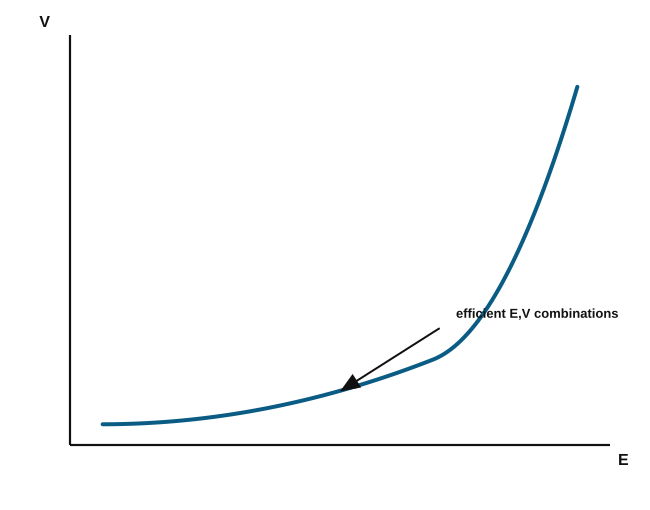
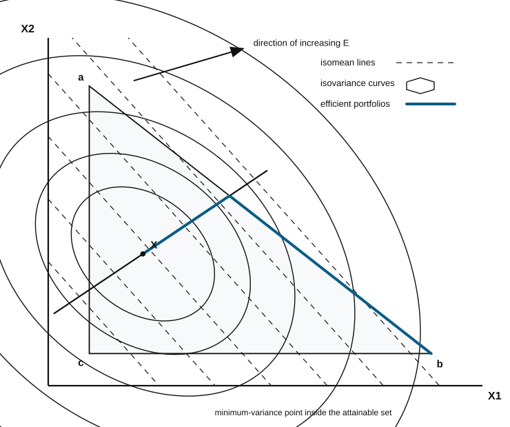

# Recreating Markowitz Portfolio Selection

A reproducible recreation of the efficient-frontier geometry from Harry Markowitz's 1952 paper, "Portfolio Selection."

This project rebuilds the paper's schematic results with explicit mean and covariance assumptions, then generates the efficient frontier, the long-only portfolio paths, and a browser-readable report.

## Why This Project Matters

This is a compact quantitative finance project that demonstrates:

- mean-variance portfolio optimization
- long-only efficient frontier construction
- covariance-aware diversification
- quadratic/KKT optimization logic
- reproducible research presentation
- clear communication of assumptions and limitations

## Live Report

After GitHub Pages is enabled for this repository, the report will be available at:

https://bnjmnprto.github.io/markowitz-portfolio-selection/

You can also open the local report at `docs/index.html`.

## Results Preview





## Important Note

The original 1952 paper contains formulas and schematic figures, not a downloadable empirical dataset. The results here are therefore a faithful computational recreation of the paper's geometry using explicit synthetic beliefs:

- expected returns, `mu`
- covariance matrices, `sigma`
- long-only portfolio weights
- target-return minimum-variance portfolios

The original JSTOR PDF is not included in this repository.

## Project Structure

```text
.
├── README.md
├── requirements.txt
├── src/
│   └── recreate_markowitz_results.py
├── outputs/
│   ├── efficient_frontier_case_a.csv
│   ├── markowitz_recreation_report.html
│   └── figure_*.svg
└── docs/
    ├── index.html
    └── figure_*.svg
```

## Reproduce The Results

```bash
python3 -m pip install -r requirements.txt
python3 src/recreate_markowitz_results.py
```

The script regenerates:

- `outputs/markowitz_recreation_report.html`
- `outputs/efficient_frontier_case_a.csv`
- all SVG figure recreations
- `docs/index.html` for GitHub Pages

## Method

For portfolio weights `w`, expected returns `mu`, and covariance matrix `Sigma`:

```text
E(w) = w' mu
V(w) = w' Sigma w
sum(w) = 1
w_i >= 0
```

For each target expected return, the script enumerates active long-only asset sets and solves the KKT system for the minimum-variance portfolio. The efficient frontier starts at the feasible minimum-variance portfolio and ends at the maximum-return asset.

## Portfolio Value

This project is intentionally small, but it is designed to be legible to both technical and finance audiences: the code is reproducible, the assumptions are explicit, and the generated report explains the result without requiring a notebook environment.
